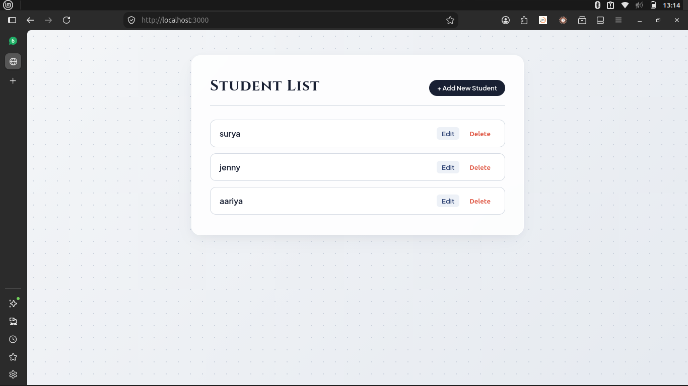

# User Details Management App

A full-stack web application built with Node.js, Express, MongoDB, Mongoose, and Tailwind CSS using EJS templating.

---

## 📸 Preview



---

## ✨ Features

- Full CRUD (Create, Read, Update, Delete) identity operations
- Server-side rendering using EJS templates
- Styled with modern Tailwind CSS and custom layouts
- Schema-based data modeling and validation using Mongoose

---

## 🛠️ Tech Stack

- **Runtime:** Node.js
- **Framework:** Express.js
- **Database:** MongoDB & Mongoose
- **View Engine:** EJS
- **Styling:** Tailwind CSS

---

## 🚀 Getting Started

### Prerequisites

- [Node.js](https://nodejs.org/) installed
- [MongoDB](https://www.mongodb.com/) running locally or a MongoDB Atlas URI

### Installation & Run

1. Clone the repository:
   ```bash
   git clone [https://github.com/](https://github.com/)<YOUR-USERNAME>/<YOUR-REPO-NAME>.git
   cd <YOUR-REPO-NAME>